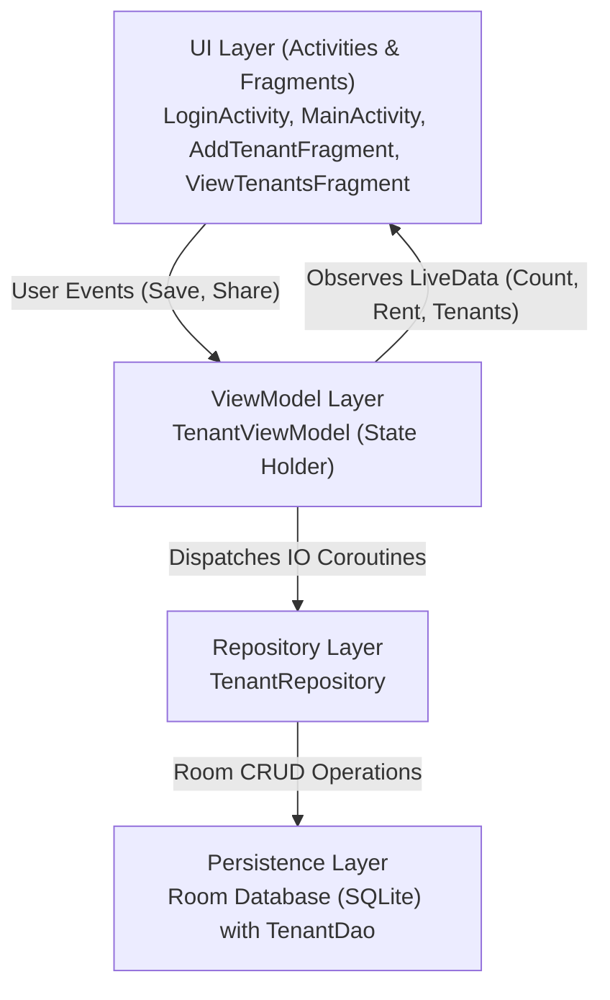

# Tenant Management System (Group A)

[](https://kotlinlang.org)
[](https://developer.android.com/build)
[](https://developer.android.com/topic/architecture)
[](https://developer.android.com/training/data-storage/room)

A modern, production-grade Android application developed for Strathmore University BBIT 3.2 Mobile Application Development course. The system solves key real estate management challenges by streamlining tenant onboarding, lease agreement tracking, rent portfolio aggregation, and inter-app communication.

---

## 🏛️ System Architecture

The application strictly implements **Clean Architecture** with the **Model-View-ViewModel (MVVM)** pattern:



---

## 📋 Course Rubric Compliance Matrix (/6 pts)

| Points | University Rubric Requirement | Codebase Implementation Details |
| :---: | :--- | :--- |
| **2 pts** | **SHARE Button on Add Tenant Screen**<br/>Shares saved tenant details with another app (WhatsApp, Messages, Gmail) using `Intent.ACTION_SEND`, `type = "text/plain"`, passing `tenant.summary()` via `putExtra(Intent.EXTRA_TEXT)`, and starting chooser. | Implemented in `AddTenantFragment.kt` via `shareTenantSummary()` calling `Intent.createChooser(sendIntent, ...)`. `Tenant.summary()` formats tenant ID, name, phone, unit, and monthly rent. |
| **2 pts** | **Email Intent Passing & Welcome Toast**<br/>Send email from `LoginActivity` to `MainActivity` with `putExtra`, read with `getStringExtra`, and show Toast: `"Logged in as ..."`. | Implemented in `LoginActivity.kt` (`putExtra("EMAIL", email)`) and `MainActivity.kt` (`getStringExtra("EMAIL")` + `Toast.makeText(this, "Logged in as $email", Toast.LENGTH_SHORT).show()`). |
| **2 pts** | **Field Emptiness Validation**<br/>Before saving, check that none of the three fields is empty and show error on empty field with `error = "Required"`. | Implemented in `AddTenantFragment.kt` and `TenantViewModel.kt`: flags `til.error = "Required"` and `et.error = "Required"` for Name, Phone, and Rent before saving. |

---

## 🌿 Collaborative Git Branching Strategy

To simulate enterprise group development and meet academic submission standards, the repository follows a structured branch workflow:

1. `main` — Production-ready, stable codebase with documentation and releases.
2. `feature/viewmodel` — Stage 2: `TenantViewModel` implementation, state holding, and reactive transformations.
3. `feature/room` — Stage 3: Room persistence layer (`@Entity`, `@Dao`, `TenantDatabase`, `TenantRepository`).
4. `feature/screens` — Stage 4: Navigation Component, `FragmentContainerView`, DrawerLayout, and screen layouts.
5. `feature/data-integration` — Stage 5: Connecting UI with ViewModel, input validation, and implicit intents.
6. `release/v1.0` — Stage 6: Final signed build, QA audits, and release tagging.

---

## 🚀 Getting Started & Build Instructions

### Prerequisites
* Android Studio Ladybug (2024.2.1+) or newer
* JDK 17
* Android SDK 34 (Android 14)
* Gradle 8.7+

### Build and Run via Gradle
```bash
# Clone the repository
git clone https://github.com/Cguru18/tenant-management-system.git
cd tenant-management-system

# Build Debug APK
./gradlew assembleDebug

# Run Unit Tests
./gradlew testDebugUnitTest
```

---

## 👥 Contributors & Academic Metadata
* **Lead Architect:** Mark Mwiti (`Cguru18` - `mwitimark.m@gmail.com`)
* **Course:** BBIT 3.2 Mobile Application Development
* **Institution:** Strathmore University
