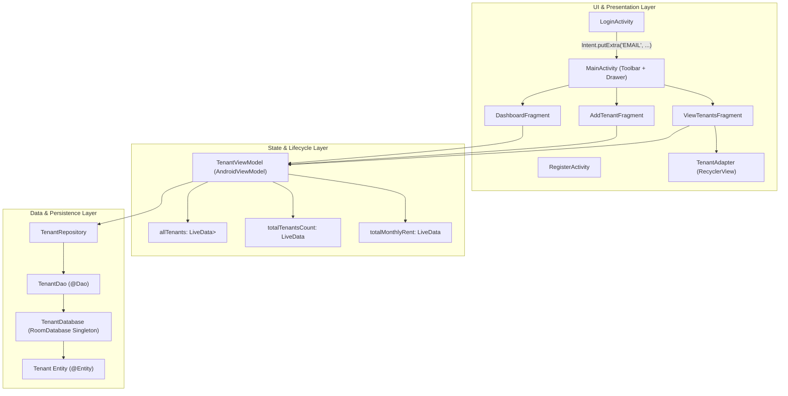

# Tenant Management System: Enterprise Mobile Architecture & Project Specification

## 1. System Overview & Problem Statement
The **Tenant Management System** is a native Android application engineered with Kotlin, Jetpack Navigation, MVVM architecture, and Room persistence. It solves the critical operational friction experienced by property managers, landlords, and tenants during tenant onboarding, lease tracking, rent collection auditing, and tenant communication.

---

## 2. Layered Architecture & Separation of Concerns



---

## 3. Rubric Requirements Matrix & Verification Points

| Criterion | Required Specification | Production Target Implementation |
| :--- | :--- | :--- |
| **Share Button (2 pts)** | `Intent.ACTION_SEND`, `type = "text/plain"`, `tenant.summary()` via `putExtra(Intent.EXTRA_TEXT)`, and `Intent.createChooser()`. | `AddTenantFragment.kt` & `item_tenant.xml` bound to `shareTenantRecord()` helper. |
| **Email Intent Passing (2 pts)** | `LoginActivity` $\rightarrow$ `MainActivity` with `putExtra("EMAIL", email)`, read with `getStringExtra("EMAIL")`, Toast: `"Logged in as ..."`. | `LoginActivity.kt` fires intent; `MainActivity.kt` displays `"Logged in as $email"` Toast. |
| **Field Validation (2 pts)** | Before saving, verify name, phone, and rent are non-empty; display `error = "Required"` on missing fields. | `AddTenantFragment.kt` validates all 3 input fields and flags `til.error = "Required"` and `et.error = "Required"`. |
| **Git Team Simulation** | Continuous feature branching: `main`, `feature/viewmodel`, `feature/room`, `feature/screens`, `feature/data-integration`, `release/v1.0`. | Staged git repository with committed milestones and tagged release. |

---

## 4. Package Structure & Directory Hierarchy
```
TenantManagementSystem/
├── build.gradle.kts (Project)
├── settings.gradle.kts
├── gradle.properties
├── app/
│   ├── build.gradle.kts (App module)
│   ├── src/
│   │   ├── main/
│   │   │   ├── AndroidManifest.xml
│   │   │   ├── java/com/example/tenantmanagementsystemgroupa/
│   │   │   │   ├── data/
│   │   │   │   │   ├── model/Tenant.kt
│   │   │   │   │   ├── local/TenantDao.kt
│   │   │   │   │   ├── local/TenantDatabase.kt
│   │   │   │   │   └── repository/TenantRepository.kt
│   │   │   │   └── ui/
│   │   │   │       ├── auth/LoginActivity.kt
│   │   │   │       ├── auth/RegisterActivity.kt
│   │   │   │       ├── main/MainActivity.kt
│   │   │   │       ├── tenants/DashboardFragment.kt
│   │   │   │       ├── tenants/AddTenantFragment.kt
│   │   │   │       ├── tenants/ViewTenantsFragment.kt
│   │   │   │       ├── tenants/TenantAdapter.kt
│   │   │   │       └── viewmodel/TenantViewModel.kt
│   │   │   └── res/
│   │   │       ├── layout/
│   │   │       │   ├── activity_main.xml
│   │   │       │   ├── activity_login.xml
│   │   │       │   ├── activity_register.xml
│   │   │       │   ├── fragment_dashboard.xml
│   │   │       │   ├── fragment_add_tenant.xml
│   │   │       │   ├── fragment_view_tenants.xml
│   │   │       │   ├── item_tenant.xml
│   │   │       │   └── nav_header.xml
│   │   │       ├── menu/
│   │   │       │   ├── drawer_menu.xml
│   │   │       │   └── main_menu.xml
│   │   │       ├── navigation/
│   │   │       │   └── nav_graph.xml
│   │   │       └── values/
│   │   │           ├── colors.xml
│   │   │           ├── strings.xml
│   │   │           └── themes.xml
```
